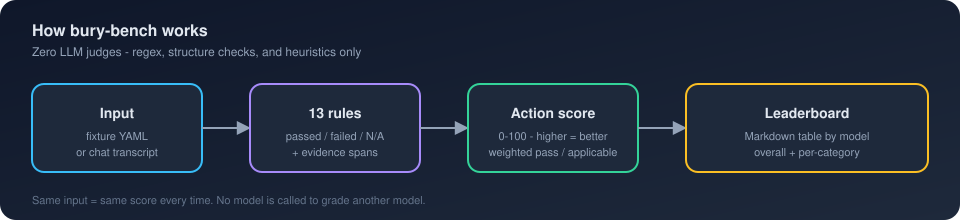
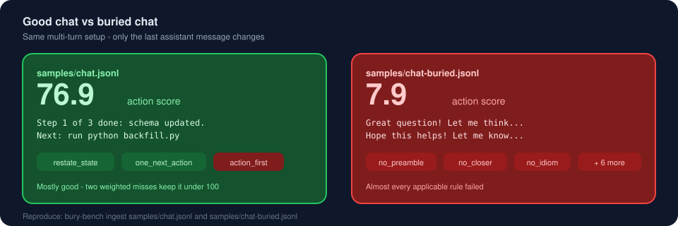
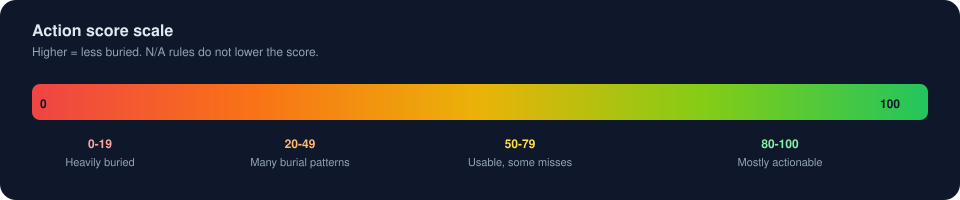

# bury-bench

[](https://github.com/Onur45500/bury-bench/actions/workflows/ci.yml)
[](LICENSE)
[](https://www.python.org/downloads/)
[](#why-zero-llm-judge)

**Deterministic benchmark for answer-burial in coding-agent responses.**

Scores replies against the [i-have-adhd](https://github.com/ayghri/i-have-adhd) output-shaping rules and builds a Markdown leaderboard. **Higher action score = better** (less buried). No LLM is ever called to grade another LLM.

> **Not on PyPI yet** — install from source with `pip install -e .`  
> **Not affiliated** with [ayghri/i-have-adhd](https://github.com/ayghri/i-have-adhd). Independent benchmark inspired by its public rules.





## 30-second demo

```bash
pip install -e ".[dev]"

# Good answer → ~76.9
bury-bench ingest samples/chat.jsonl --format jsonl --out results/ingested.json

# Buried answer → ~7.9
bury-bench ingest samples/chat-buried.jsonl --format jsonl --out results/ingested-buried.json

# Compare
bury-bench leaderboard results/ingested.json results/ingested-buried.json --out docs/INGEST_LEADERBOARD.md
```

| Sample | Score | Meaning |
|--------|------:|---------|
| [`samples/chat.jsonl`](samples/chat.jsonl) | **76.9** | Clear next step; two weighted misses |
| [`samples/chat-buried.jsonl`](samples/chat-buried.jsonl) | **7.9** | Preamble, hedges, idioms, closers |

## Table of contents

- [Why zero-LLM-judge?](#why-zero-llm-judge)
- [Install](#install)
- [Quickstart](#quickstart)
- [Interpreting scores](#interpreting-scores)
- [Rulesets](#rulesets)
- [Rules](#rules)
- [Ingest transcripts](#ingest-transcripts)
- [Fixtures](#fixtures)
- [Golden regressions](#golden-regressions)
- [Contributing](#contributing)
- [License](#license)

## Why zero-LLM-judge?

LLM-as-judge is expensive, non-reproducible, and easy to game with style that
pleases the judge. bury-bench trades fuzzy nuance for **transparency**: every
failure includes the matched evidence span, and the same response always gets
the same score.

## Install

Requires **Python 3.11+**.

```bash
python -m venv .venv
# Windows: .venv\Scripts\activate
source .venv/bin/activate

pip install -e ".[dev]"          # CLI + tests
pip install -e ".[providers]"    # optional OpenAI-compat / Anthropic adapters
```

## Quickstart

```bash
bury-bench list-rules
bury-bench list-rules --ruleset adhd-v1

# Paste a response interactively (no API keys). End paste with a line: END
bury-bench run --provider paste --fixtures fixtures/install/install-001.yaml --out results/paste.json

# CI demo leaderboard (committed samples — not your ingest runs)
bury-bench leaderboard samples --out docs/LEADERBOARD.md

bury-bench check-golden
bury-bench validate-results samples
```

Optional live providers (keys from env; never committed):

```bash
export OPENAI_API_KEY=...
bury-bench run --provider openai --model gpt-4o-mini --fixtures fixtures/ --out results/gpt-4o-mini.json

export ANTHROPIC_API_KEY=...
bury-bench run --provider anthropic --model claude-sonnet-4-20250514 --fixtures fixtures/ --out results/claude.json
```

Score offline JSON:

```bash
bury-bench score --responses my_responses.json --out results/custom.json --ruleset adhd-v2
```

## Interpreting scores



| Range | Meaning |
|------:|---------|
| **80–100** | Mostly actionable |
| **50–79** | Usable; a few weighted misses (e.g. `action_first`) |
| **20–49** | Several burial patterns |
| **0–19** | Heavily buried |

Each rule returns:

| Status | Effect on score |
|--------|-----------------|
| `passed` | Counts toward numerator |
| `failed` | Counts in denominator only — see `evidence` for why |
| `not_applicable` | **Ignored** (does not lower the score) |

```text
action score = 100 × (Σ weights of passed) / (Σ weights of applicable)
```

### Reading the worked example

Both samples share the same multi-turn setup; only the last assistant message differs.

**Good (~76.9)** — restates `Step 1 of 3`, gives `Next: run …`, no preamble/closer.
Fails `action_first` (opens with status, not a command) and `visible_wins`.

**Buried (~7.9)** — fails almost every applicable rule (`no_preamble`, `no_closer`,
`no_hedge_filler`, `no_idiom`, `no_tangent`, `restate_state`, …).

Open `results/ingested.json` / `results/ingested-buried.json` for the full
per-rule breakdown.

| Command | Purpose |
|---------|---------|
| `check-golden` | Scorer regression suite (hand-labeled expectations) |
| `leaderboard samples` | CI demo board from committed `samples/*.json` |
| `leaderboard results/…` | Board from **your** ingest/score runs |

## Rulesets

| Pack | Contents |
|------|----------|
| `adhd-v1` | Original 11 single-turn checks (historical scores stay comparable) |
| `adhd-v2` (default) | V1 + `restate_state` (rule 5) + `visible_wins` (rule 7) |

Multi-turn rules are `not_applicable` on single-turn responses, so V1 and V2
scores match when no prior assistant context is provided.

## Rules

Derived from the public
[SKILL.md](https://raw.githubusercontent.com/ayghri/i-have-adhd/main/skills/i-have-adhd/SKILL.md):

| Rule | Source | Notes |
|------|--------|-------|
| `action_first` | Rule 1 | Proxy: first line has command/path/code/imperative |
| `numbered_steps` | Rule 2 | ≥2 prose sequence markers without a numbered list → fail |
| `one_next_action` | Rule 3 | Proxy: last paragraph has one clear next step |
| `no_tangent` | Rule 4 | Sidebar markers (“by the way”, …) |
| `restate_state` | Rule 5 | Multi-turn: restate step N/M and named artifacts |
| `time_estimate` | Rule 6 | N/A unless estimate language; vague fails |
| `visible_wins` | Rule 7 | Multi-turn: show what now works; no buried recap |
| `error_tone` | Rule 8 | “Uh oh”, “Oh no”, “There seems to be a problem”, … |
| `capped_lists` | Rule 9 | Any markdown list group > 5 items fails |
| `no_preamble` | Rule 10 | Forbidden openers |
| `no_closer` | Rule 10 | Forbidden closers |
| `no_hedge_filler` | Pre-send 4 | Density ≈1 hedge / 100 prose words |
| `no_idiom` | Pre-send 5 | Curated idiom phrase list |

Text rules run on prose with code stripped. `restate_state` still inspects raw
text for backtick artifacts. Proxy limits are listed in the golden notes below.

## Ingest transcripts

```bash
bury-bench ingest samples/chat.jsonl --format jsonl --out results/ingested.json
bury-bench ingest export.json --format cursor-export --out results/ingested.json
bury-bench ingest session.md --format markdown --out results/ingested.json
```

The **last assistant message** is scored; earlier turns become multi-turn
context. The model label on the leaderboard is the **input filename stem**.

## Fixtures

Categories: `debug`, `install`, `fix`, `explain`, `ambiguous` (~88 MIT fixtures).

```yaml
# SPDX-License-Identifier: MIT
id: debug-mt-001
category: debug
turns:
  - role: user
    content: Migration failed.
  - role: assistant
    content: |
      Step 1 of 4 done: added nullable column.
prompt: |
  continue
```

## Golden regressions

Hand-scored cases in [`golden/`](golden/):

```bash
bury-bench check-golden
# or: pytest tests/test_golden.py
```

| Rule | Known proxy limit |
|------|-------------------|
| `action_first` | Finite imperative list |
| `one_next_action` | Soft closes fail; closed forms are N/A |
| `restate_state` | State card = steps, artifacts, commands, checklist, known paraphrases |
| `visible_wins` | Phrase lists for claims / buried recaps |
| `no_hedge_filler` | Density **or** opening hedge cluster; short single hedge allowed |

## Contributing

See [CONTRIBUTING.md](CONTRIBUTING.md). Please follow the
[Code of Conduct](CODE_OF_CONDUCT.md). Security reports: [SECURITY.md](SECURITY.md).

```bash
pip install -e ".[dev]"
pytest
python scripts/generate_samples.py
bury-bench leaderboard samples --out docs/LEADERBOARD.md
```

CI runs pytest, golden checks, validates `samples/`, and fails if
`docs/LEADERBOARD.md` is stale — no live API calls.

## License

MIT. Fixtures and golden cases are also MIT. See [CHANGELOG.md](CHANGELOG.md).
